# Bennett Toolbox

多功能工具箱桌面应用，基于 Electron + React + TypeScript，内置 11 个常用工具。

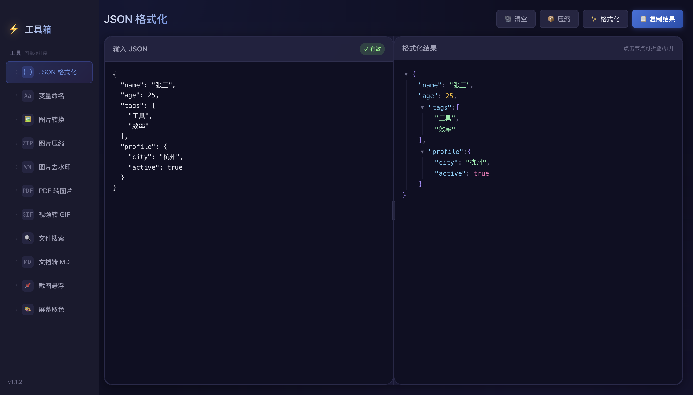

## 功能

- JSON 格式化与压缩
- 中英变量命名转换
- 图片格式转换与批量压缩
- 图片去水印
- PDF 转图片
- 视频转 GIF
- 文件搜索
- 文档转 Markdown
- 截图悬浮
- 屏幕取色

## 功能截图

截图使用演示数据与合成屏幕源，不包含个人文件或桌面内容。

| 功能 | 说明与界面 |
| --- | --- |
| **JSON 格式化** | 格式化、压缩、复制结果，语法错误定位到行列。<br> |
| **变量命名** | 中英互译并生成 camelCase、PascalCase、snake_case 等 6 种命名格式。<br>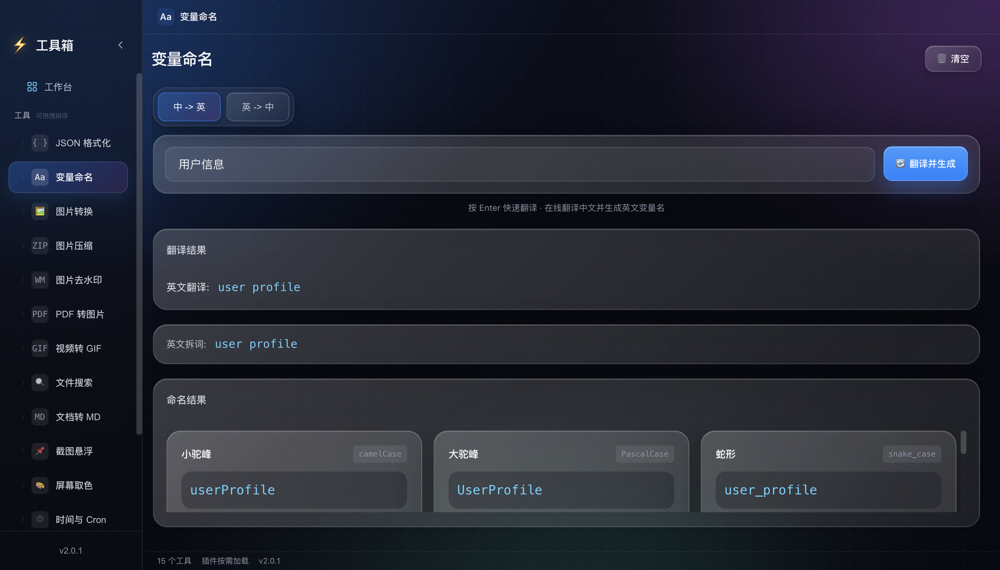 |
| **图片转换** | 批量转换 PNG、JPG、WebP、HEIC、SVG，支持质量调节与 ZIP 导出。<br>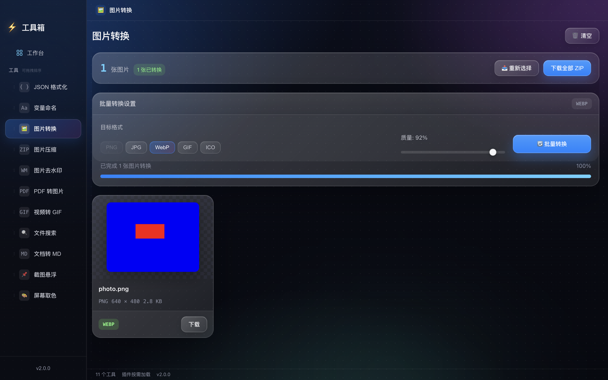 |
| **图片压缩** | 按目标大小或质量批量压缩，支持 JPG/WebP 与 ZIP 导出。<br>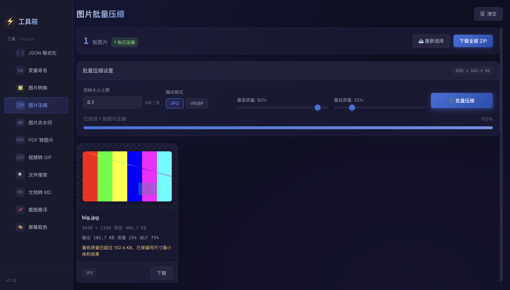 |
| **图片去水印** | 画笔或框选遮罩，局部修补后预览并下载结果。<br>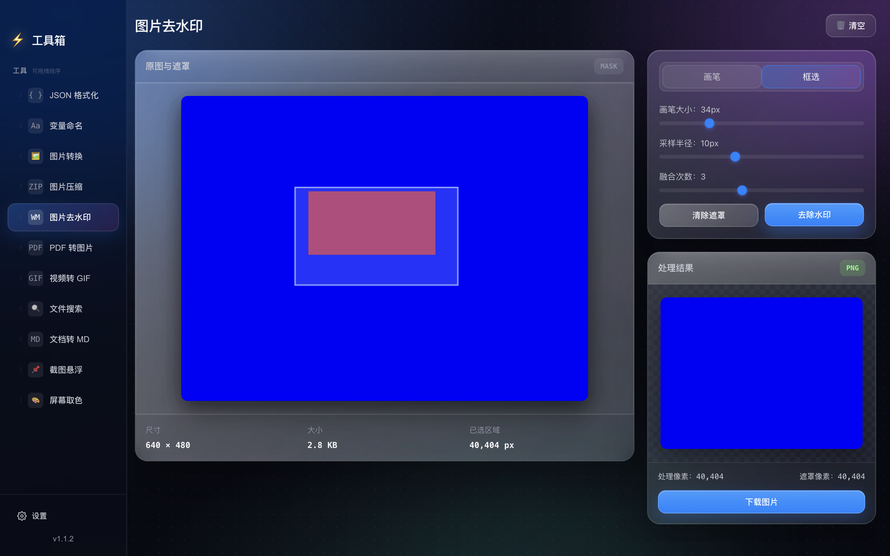 |
| **PDF 转图片** | 按页导出 JPG/PNG，清晰度与质量可调，支持 ZIP 打包。<br>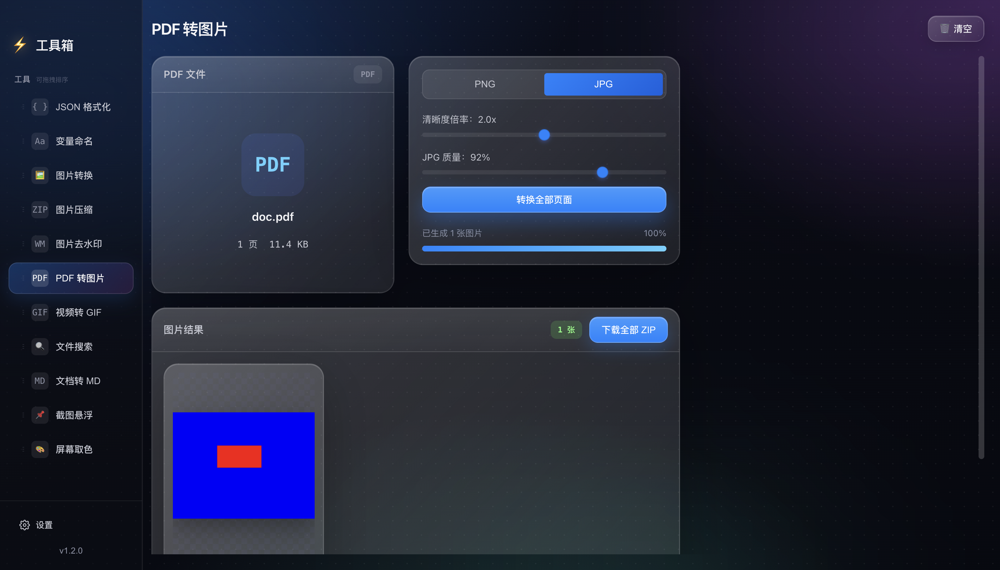 |
| **视频转 GIF** | 截取区间，设置帧率、尺寸与质量，生成并下载 GIF。<br>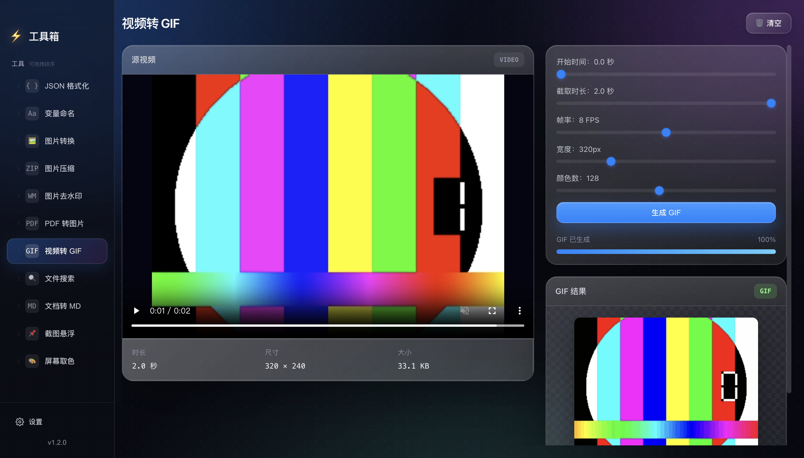 |
| **文件搜索** | 按目录递归搜索文件名，支持深度、排序、打开与在文件夹中显示。<br>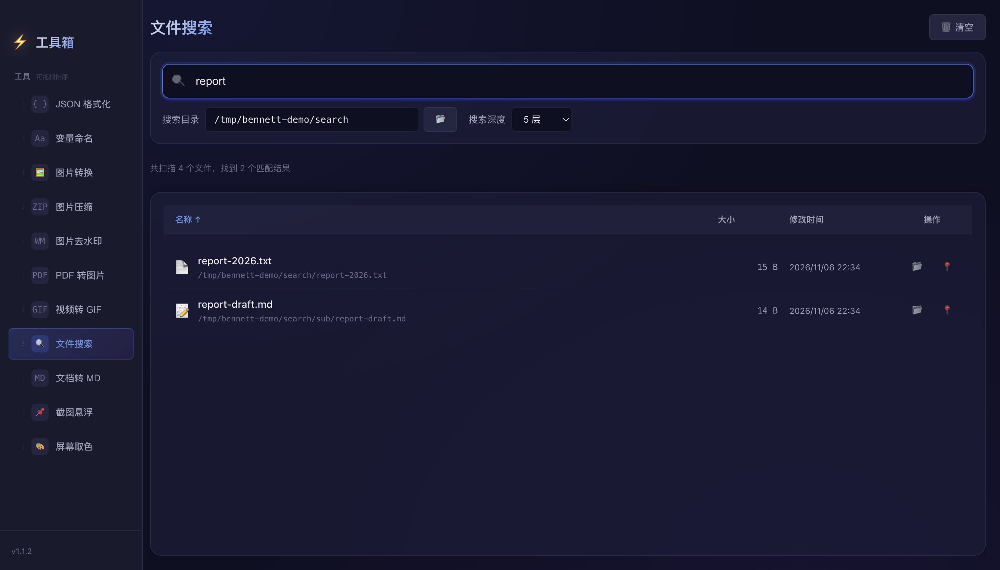 |
| **文档转 MD** | 调用 MarkItDown 转换 PDF、Office、HTML 等格式，可复制或保存 Markdown。<br>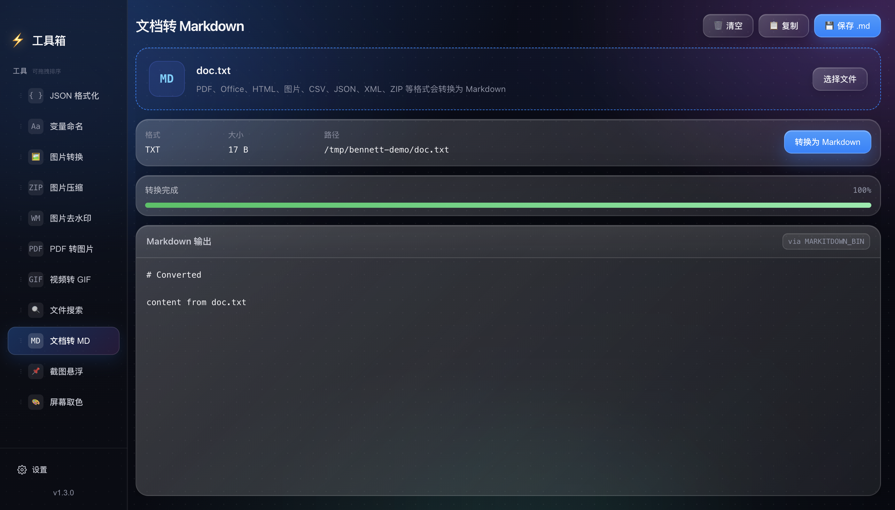 |
| **截图悬浮** | 选择屏幕源，支持整屏与框选截图、悬浮置顶、复制和下载。<br>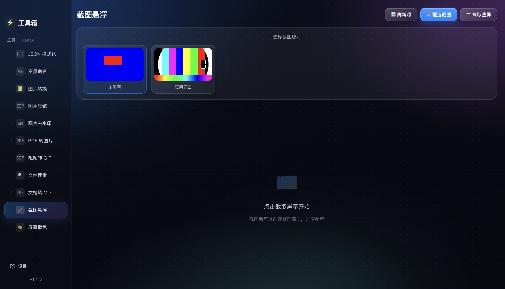 |
| **屏幕取色** | EyeDropper 取色，展示 HEX、RGB、HSL、CSS 格式与历史记录。<br>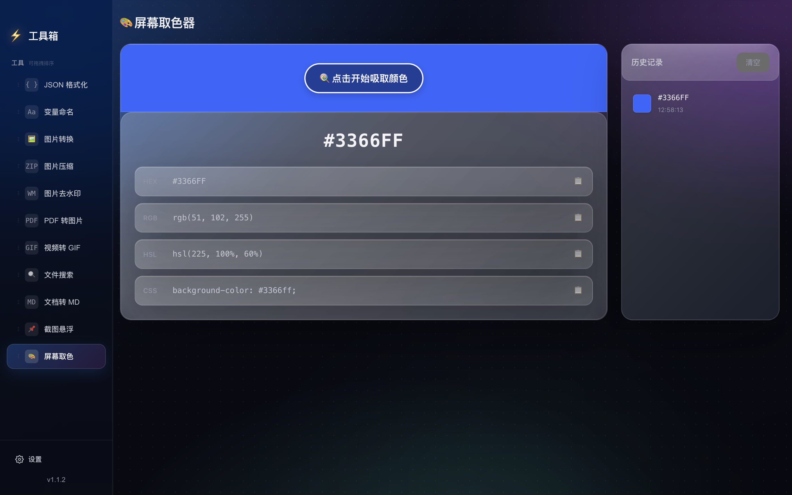 |

## 技术栈

- Electron 28
- React 19.3.1 + TypeScript 5
- Vite 5
- Playwright e2e

## 已验证

- Node.js v26.13.0（最新 LTS）
- `npx tsc --noEmit` 0 错误
- `npx vite build` 成功
- 浏览器 e2e：3/3 通过
- Electron 打包版功能 e2e：48/48 通过（11 个模块 + 侧边栏 + 主进程 IPC）
- Electron 打包版冒烟 e2e：7/7 通过
- `npm run build:electron` 成功

## 快速开始

```bash
npm install
npm run setup:markitdown  # 可选：准备文档转换器（文档转 MD 需要）
npm run dev              # 前端开发服务器 http://127.0.0.1:5173
npm run test:e2e         # 浏览器冒烟测试（3 项）
npm run build:all        # 构建前端与主进程
npm run test:electron    # Electron 功能测试（48 项，需先构建；CI 跳过 7 项屏幕用例）
npm run test:electron:smoke  # Electron 冒烟测试（7 项）
```

对打包产物运行功能测试：

```bash
ELECTRON_APP_PATH="$PWD/release/Bennett Toolbox-darwin-arm64/Bennett Toolbox.app/Contents/MacOS/Bennett Toolbox" \
  npm run test:electron
```

测试素材位于 `tests/fixtures/`。

运行 Electron 需要系统安装 Electron 28 运行时（`electron .`）。

## 目录结构

```
├── electron/main.ts          # 主进程：窗口、IPC、HEIC、MarkItDown、截图
├── src/main.tsx              # React 入口
├── src/App.tsx               # 模块注册表、切换、拖拽排序持久化
├── src/components/Sidebar.tsx
├── src/components/FormatItem.tsx   # 颜色格式复制行
├── src/modules/              # 11 个工具模块
│   ├── JsonFormatter.tsx
│   ├── NamingConverter.tsx
│   ├── ImageConverter.tsx
│   ├── ImageCompressor.tsx
│   ├── WatermarkRemoval.tsx
│   ├── PdfToImages.tsx
│   ├── VideoToGif.tsx
│   ├── FileSearch.tsx
│   ├── DocumentConverter.tsx
│   ├── ScreenshotFloat.tsx
│   └── ColorPicker.tsx
├── src/shared/               # 版本号与类型
├── src/styles/global.css     # 全局样式
├── docs/screenshots/         # README 功能截图
├── scripts/capture-screenshots.mjs
├── scripts/setup-markitdown.sh
├── vendor/markitdown/         # MarkItDown 转换器（二进制不入库）
├── tests/fixtures/          # 测试素材（images/documents/video/markitdown/search）
├── tests/smoke.e2e.ts
├── tests/electron.full.mjs
└── e2e.config.ts
```

## 模块一览

| 模块 | 文件 | 说明 |
| --- | --- | --- |
| JSON 格式化 | `modules/JsonFormatter.tsx` | 格式化、压缩、复制结果、语法错误定位 |
| 变量命名 | `modules/NamingConverter.tsx` | 中英互译并生成常见命名格式 |
| 图片转换 | `modules/ImageConverter.tsx` | PNG/JPG/WebP/HEIC/SVG 等格式转换 |
| 图片压缩 | `modules/ImageCompressor.tsx` | 按目标大小或质量批量压缩 |
| 图片去水印 | `modules/WatermarkRemoval.tsx` | 涂抹或框选后修补水印区域 |
| PDF 转图片 | `modules/PdfToImages.tsx` | 按页导出 PNG/JPG，可打包 ZIP |
| 视频转 GIF | `modules/VideoToGif.tsx` | 截取片段、设置帧率与尺寸 |
| 文件搜索 | `modules/FileSearch.tsx` | 按文件名搜索目录，支持在文件夹中显示 |
| 文档转 MD | `modules/DocumentConverter.tsx` | 调用 MarkItDown 转换文档 |
| 截图悬浮 | `modules/ScreenshotFloat.tsx` | 屏幕源截图、框选截图、悬浮置顶 |
| 屏幕取色 | `modules/ColorPicker.tsx` | EyeDropper 取色与历史记录 |

## 发布与安装包

推送 `v*` tag 时，GitHub Actions 会自动构建并附加到对应 Release；也可以在 Actions 页面手动触发。

产物清单：

- macOS x64 / arm64：`dmg` 与 `zip`
- Windows x64 / arm64：NSIS 安装包（`exe`）

文件命名：`Bennett-Toolbox-<version>-<arch>.<ext>`。

本地打包：

```bash
npm run build:all
npm run package:mac   # dmg + zip
npm run package:win   # NSIS exe
```

产物默认未签名、未公证：

- macOS 首次打开需右键「打开」，或在「系统设置 > 隐私与安全性」中允许。
- Windows 会出现 SmartScreen 提示，选择「更多信息 > 仍要运行」。

## 开发说明

1. 渲染进程通过 `ipcRenderer` / `ipcMain` 与主进程通信，通道定义见 `electron/main.ts`。
2. 当前启用 `nodeIntegration: true`、`contextIsolation: false`，渲染进程可直接使用 `window.require`；请勿加载不可信页面。
3. MarkItDown：本地执行 `npm run setup:markitdown`；CI 中 macOS arm64 从 Release 资源下载，其他平台用 PyInstaller 构建，打包时通过 `extraResources` 打入应用。
