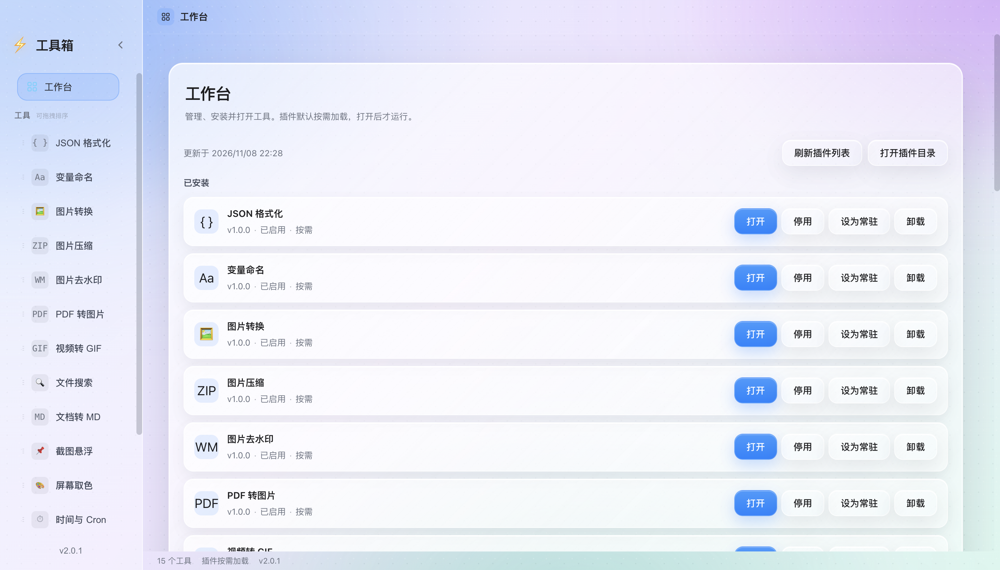
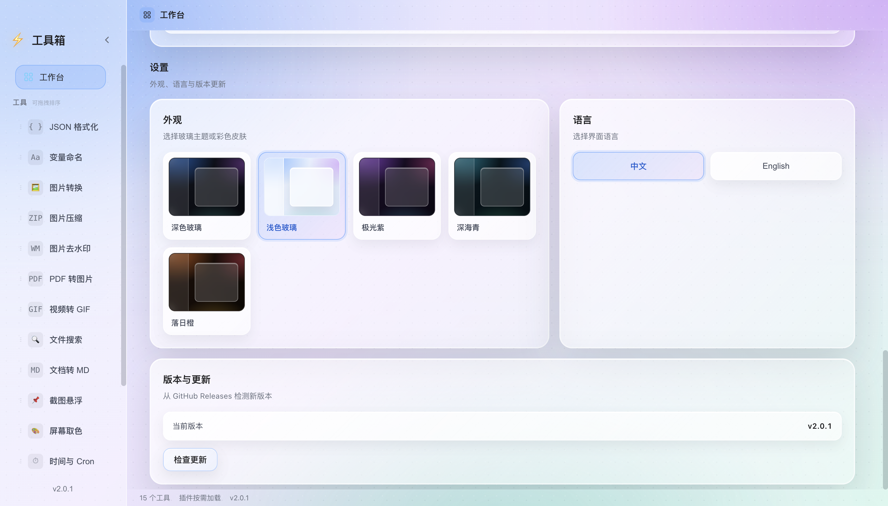
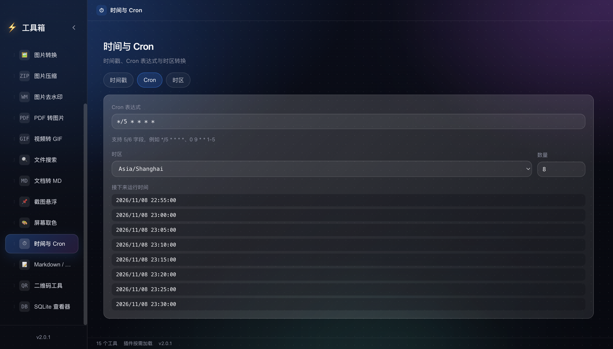
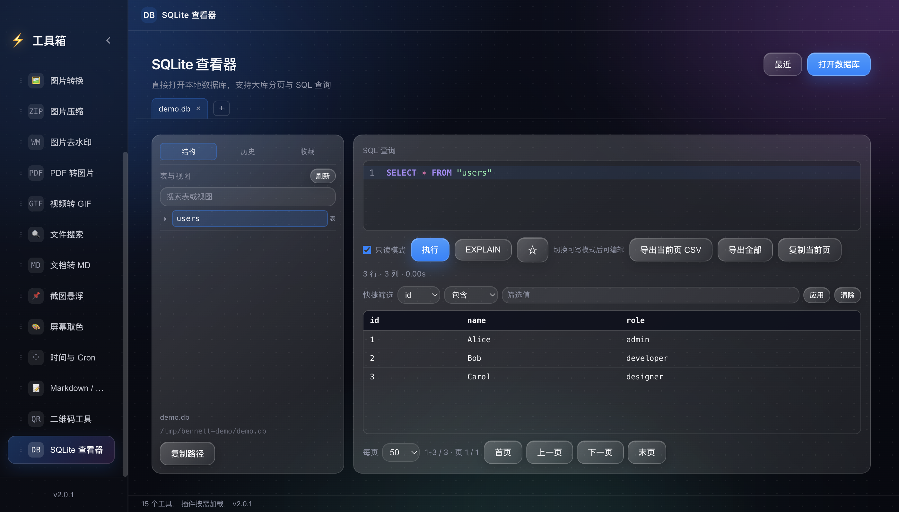
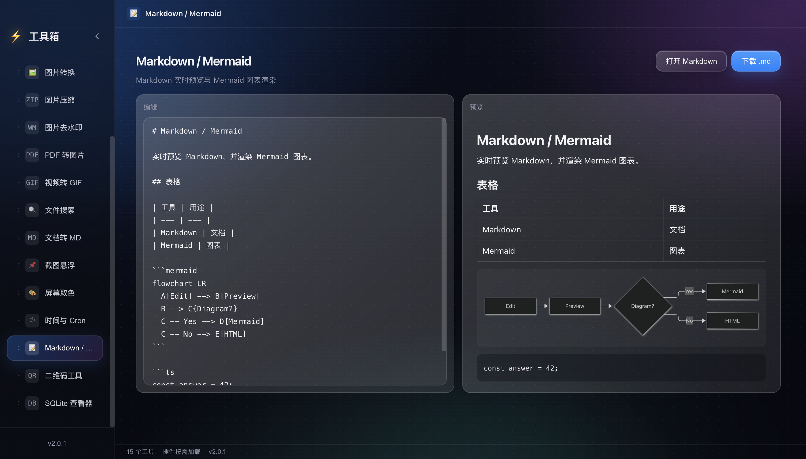
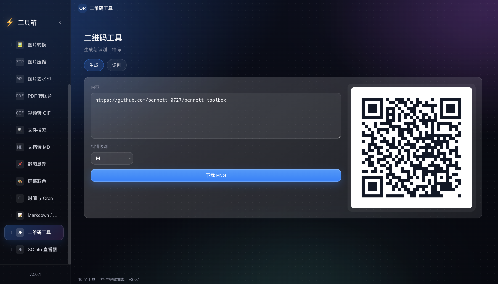
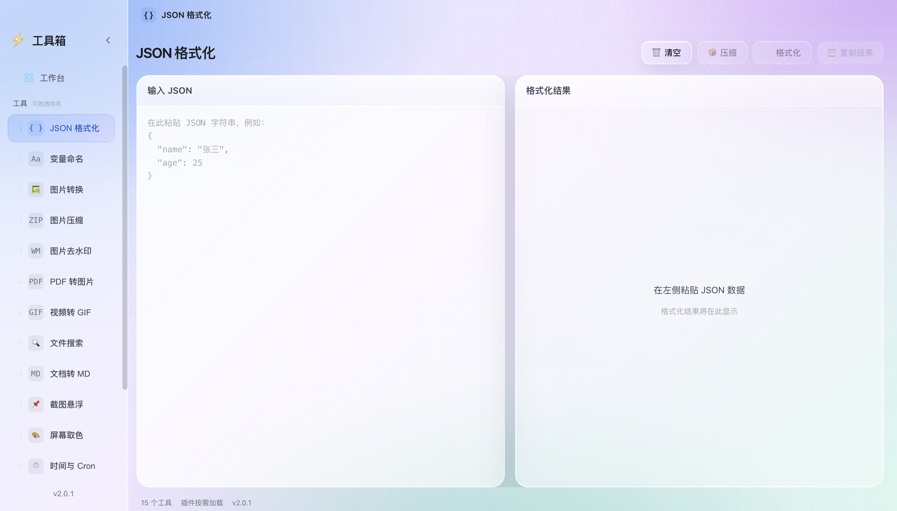

# Bennett Toolbox

多功能工具箱桌面应用，基于 Electron + React + TypeScript。11 个常用工具以官方插件形式按需安装，应用壳提供插件管理、主题、语言与组件下载。


## 功能

- JSON 格式化与压缩
- 中英变量命名转换
- 图片格式转换与批量压缩
- 图片去水印
- PDF 转图片
- 视频转 GIF
- 文件搜索
- 文档转 Markdown
- 截图悬浮
- 屏幕取色
- 插件管理：安装、启用、停用、常驻/按需、更新与卸载
- 示例插件：文本统计 `bennett.text-stats`

## 功能截图

截图使用演示数据与合成屏幕源，不包含个人文件或桌面内容。

| 功能 | 说明与界面 |
| --- | --- |
| **JSON 格式化** | 格式化、压缩、复制结果，语法错误定位到行列。<br> |
| **变量命名** | 中英互译并生成 camelCase、PascalCase、snake_case 等 6 种命名格式。<br> |
| **图片转换** | 批量转换 PNG、JPG、WebP、HEIC、SVG，支持质量调节与 ZIP 导出。<br> |
| **图片压缩** | 按目标大小或质量批量压缩，支持 JPG/WebP 与 ZIP 导出。<br> |
| **图片去水印** | 画笔或框选遮罩，局部修补后预览并下载结果。<br> |
| **PDF 转图片** | 按页导出 JPG/PNG，清晰度与质量可调，支持 ZIP 打包。<br> |
| **视频转 GIF** | 截取区间，设置帧率、尺寸与质量，生成并下载 GIF。<br> |
| **文件搜索** | 按目录递归搜索文件名，支持深度、排序、打开与在文件夹中显示。<br> |
| **文档转 MD** | 调用 MarkItDown 转换 PDF、Office、HTML 等格式；MarkItDown 作为按需下载组件，不随安装包分发。<br> |
| **截图悬浮** | 选择屏幕源，支持整屏与框选截图、悬浮置顶、复制和下载。<br> |
| **屏幕取色** | EyeDropper 取色，展示 HEX、RGB、HSL、CSS 格式与历史记录。<br> |
| **工作台** | 默认进入工作台，安装、卸载、停用或打开插件；顶部/底部状态栏常驻，工具占满主画布。<br> |
| **工作台设置** | 工作台内直接切换深色、浅色与彩色玻璃皮肤、界面语言与版本更新，不再有独立设置入口。<br> |

### 可选开发者工具

以下插件按需安装，不随“安装全部推荐工具”自动安装。

| 工具 | 说明 |
| --- | --- |
| **时间与 Cron** | 时间戳解析、Cron 下次运行时间、IANA 时区转换。<br> |
| **SQLite 查看器** | Schema 浏览、分页与快捷筛选、CodeMirror SQL 高亮/补全、历史/收藏、单表编辑与事务、全量导出。<br> |
| **Markdown / Mermaid** | Markdown 实时预览、Mermaid 图表渲染，支持打开/下载 .md。<br> |
| **二维码工具** | 生成 PNG 二维码，上传图片识别并复制结果。<br> |

### 设置、语言与屏幕适配

- 默认进入工作台，不自动加载插件；打开工具后占满主画布，侧栏与顶栏常驻；侧栏可收起为 64px 图标栏
- 工作台内直接切换 中文 / English 与五套玻璃主题，侧栏不再单设设置入口
- 内置深色玻璃、浅色玻璃、极光紫、深海青、落日橙；外观分区提供对应配色预览，选择保存到本地并在重启后恢复
- 设置页同时显示当前版本、检查更新与“前往下载”入口
- 界面文案、错误提示、主进程对话框与悬浮窗文案均支持中英双语
- 使用内联 SVG 图标，不把中文烘焙进图标或位图
- 已验证 1000×700 与 1200×760 窗口下无横向溢出，设置页自动单列，英文侧边栏不截断



### 插件

- 工作台从独立插件仓库读取 registry，支持安装、启用/停用、常驻/按需、更新、打开与卸载
- 插件默认不预装；安装下载 ZIP 到用户数据目录，卸载删除插件文件与状态
- 插件包为 ZIP，包含 `plugin.json` 与 IIFE `main.js`，安装到用户数据目录后由应用加载
- 常驻插件在启动时预加载，按需插件首次打开时加载；停用或卸载时执行清理
- 首个示例插件 `bennett.text-stats` 提供字符、单词、行数、字节与阅读时长统计
- 插件仓库：https://github.com/bennett-0727/bennett-toolbox-plugins
- 插件在受信渲染进程中运行，安装包使用 SHA-256 校验；仅从插件仓库的 GitHub Release 下载
- MarkItDown 作为独立组件按需下载，安装包不再内置约 104MB 二进制；工作台提供组件状态与下载入口


## 版本更新

- 应用启动时读取 GitHub Releases，自动检测是否有新版本
- 侧边栏版本号或设置页“检查更新”可手动检查；有新版本时显示提示条和“前往下载”
- 仅检测与跳转，不自动下载或安装；只允许打开本仓库的 GitHub 链接

## MCP 试点

本地 AI 客户端可通过 stdio MCP 直接调用这些工具：

完整工具参数、客户端配置、日志、安全与故障排查见 **[docs/mcp.md](docs/mcp.md)**。

项目内提供 AI 使用指南 skill：`.qoder/skills/bennett-toolbox-mcp/SKILL.md`；复制到 `~/.qoder-cn/skills/` 可在其他项目复用。

- `json_format`：格式化/压缩 JSON
- `sqlite_query`：只读执行单条 SQL，限制返回行数，拒绝写语句
- `markitdown_convert`：调用本机 MarkItDown 组件转换本地文档
- `file_search`：按文件名递归搜索目录，限制深度与结果数
- `time_convert`：epoch/ISO 时间在 IANA 时区间转换
- `cron_next`：计算 Cron 表达式的下次运行时间
- `qr_generate`：生成 PNG（MCP image）或 SVG 二维码
- `encoding_convert`：Base64 / URL / Hex 编解码
- `hash_text`：MD5/SHA1/SHA256/SHA512 与 HMAC-SHA256
- `jwt_decode`：解码 JWT，可用 HMAC 密钥校验签名
- `regex_test`：正则匹配、分组与替换
- `text_diff`：unified diff 与增删行统计
- `image_info`：读取图片格式、尺寸与大小
- `image_convert`：转换 PNG/JPEG/WebP、质量控制与缩放，返回 MCP image

启动服务（需要 Node.js 24+，仓库验证环境为 Node 26）：

```bash
npm run mcp
```

MCP 客户端配置示例（客户端需使用 Node 24+ 的绝对路径）：

```json
{
  "mcpServers": {
    "bennett-toolbox": {
      "command": "/path/to/node",
      "args": ["/path/to/bennett-toolbox/mcp/server.mjs"],
      "env": {
        "MARKITDOWN_BIN": "/optional/path/to/markitdown"
      }
    }
  }
}
```

`MARKITDOWN_BIN` 可省略，服务会自动查找已安装的文档转换组件。SQLite 工具始终以只读方式打开数据库，只允许单条查询。

### 下载发布版

MCP 服务独立发布，不影响桌面应用版本：https://github.com/bennett-0727/bennett-toolbox/releases?q=mcp-v

- `bennett-mcp-*.zip`：解压后执行 `npm install && npm start`，包含 sharp，图片工具可用。
- `bennett-mcp-*.mjs`：直接 `node bennett-mcp-*.mjs`；图片工具需要另行安装 sharp。
- 每个产物附带 `.sha256` 校验文件。

### MCP 操作日志

每次工具调用会写入 JSONL 日志，包含工具名、参数摘要、耗时、成功状态与错误；secret/key/token/password 自动脱敏，长文本截断。默认位置：

- macOS：`~/Library/Logs/bennett-toolbox/mcp.log`
- Windows：`%LOCALAPPDATA%\bennett-toolbox\logs\mcp.log`
- Linux：`~/.local/state/bennett-toolbox/mcp.log`

可用 `BENNETT_MCP_LOG_DIR` 覆盖目录；超过 5MB 自动轮转为 `mcp.log.1`。

## 技术栈

- Electron 45
- React 19.3.1 + TypeScript 7
- Vite 8
- Playwright e2e

## 已验证

- Node.js v26.13.0（最新 LTS）
- `npx tsc --noEmit` 0 错误
- `npx vite build` 成功
- 浏览器 e2e：3/3 通过
- Electron 打包版功能 e2e：55/55 通过（安装 11 个官方插件后覆盖全部模块 + 设置页 + 侧边栏展开收起 + 主进程 IPC）
- 插件单元测试：6/6 通过
- 插件安装/加载/停用/更新/安全拒绝/组件下载/跨版本复用/并发状态/单实例 e2e：6/6 通过
- MCP：14 个工具（JSON、SQLite 只读、MarkItDown、文件搜索、时间/Cron、二维码、编码/哈希/JWT、正则/Diff、图片）与操作日志集成测试 9/9 通过
- 浏览器壳层 e2e：3/3 通过（工作台、内嵌设置、语言/主题）
- Electron 冒烟：空壳与安装 11 个插件两种模式通过
- `npm run build:electron` 成功
- 安装包：1.3.0 macOS arm64 dmg 231MB → 122MB；2.0.0 工具模块全部移出，应用壳 asar 约 2.9MB，11 个官方插件合计约 1.6MB
- 文档转换：MarkItDown 改为 onedir 组件并预热，首次安装后单次转换约 1 秒
- 布局：默认工作台、不自动加载插件；工具占满主画布，设置直接嵌入工作台

## 快速开始

```bash
npm install
npm run setup:markitdown  # 可选：准备文档转换器（文档转 MD 需要）
npm run dev              # 前端开发服务器 http://127.0.0.1:5173
npm run test:e2e         # 浏览器冒烟测试（3 项）
npm run build:all        # 构建前端与主进程
npm run test:electron    # Electron 功能测试（55 项；需先构建并准备插件仓库）
npm run test:unit        # 插件规则单元测试（6 项）
npm run test:plugins     # 插件安装/加载/安全/组件下载/跨版本复用/并发状态/单实例 e2e（6 项，需先构建）
npm run test:mcp         # MCP：14 个工具、操作日志与 9 项集成测试
npm run mcp              # 启动 stdio MCP 服务（Node 24+）
npm run test:electron:smoke  # Electron 冒烟；设置 BENNETT_PLUGIN_REGISTRY_DIR 时安装 11 个插件
```

Electron 测试会自动查找插件仓库：优先 `BENNETT_PLUGIN_REGISTRY_DIR`，其次 `vendor/bennett-toolbox-plugins`，最后同级目录 `../bennett-toolbox-plugins`；找不到 `dist` 时会自动 `npm ci && npm run release`。

对打包产物运行功能测试：

```bash
ELECTRON_APP_PATH="$PWD/release/Bennett Toolbox-darwin-arm64/Bennett Toolbox.app/Contents/MacOS/Bennett Toolbox" \
  npm run test:electron
```

测试素材位于 `tests/fixtures/`。

运行 Electron 需要系统安装 Electron 45 运行时（`electron .`）。

## 目录结构

```
├── electron/main.ts          # 主进程：窗口、IPC、HEIC、MarkItDown、截图
├── electron/plugins/         # 插件校验、安装、状态与 IPC
├── src/main.tsx              # React 入口
├── src/App.tsx               # 模块注册表、切换、拖拽排序持久化
├── src/components/Sidebar.tsx
├── src/components/SettingsPage.tsx  # 设置页：主题、语言、版本与更新
├── src/components/FormatItem.tsx   # 颜色格式复制行
├── src/plugins/              # 插件运行时、管理器与 IPC 客户端
├── src/components/           # 工作台、内嵌设置、侧栏、插件/组件管理
│   ├── JsonFormatter.tsx
│   ├── NamingConverter.tsx
│   ├── ImageConverter.tsx
│   ├── ImageCompressor.tsx
│   ├── WatermarkRemoval.tsx
│   ├── PdfToImages.tsx
│   ├── VideoToGif.tsx
│   ├── FileSearch.tsx
│   ├── DocumentConverter.tsx
│   ├── ScreenshotFloat.tsx
│   └── ColorPicker.tsx
├── src/shared/               # 版本号与类型
├── src/styles/global.css     # 全局样式
├── docs/screenshots/         # README 功能截图
├── scripts/capture-screenshots.mjs
├── scripts/setup-markitdown.sh
├── vendor/markitdown/         # MarkItDown 转换器（二进制不入库）
├── tests/fixtures/          # 测试素材（images/documents/video/markitdown/search）
├── tests/smoke.e2e.ts
├── tests/electron.full.mjs
└── e2e.config.ts
```

## 模块一览

| 模块 | 文件 | 说明 |
| --- | --- | --- |
| JSON 格式化 | `modules/JsonFormatter.tsx` | 格式化、压缩、复制结果、语法错误定位 |
| 变量命名 | `modules/NamingConverter.tsx` | 中英互译并生成常见命名格式 |
| 图片转换 | `modules/ImageConverter.tsx` | PNG/JPG/WebP/HEIC/SVG 等格式转换 |
| 图片压缩 | `modules/ImageCompressor.tsx` | 按目标大小或质量批量压缩 |
| 图片去水印 | `modules/WatermarkRemoval.tsx` | 涂抹或框选后修补水印区域 |
| PDF 转图片 | `modules/PdfToImages.tsx` | 按页导出 PNG/JPG，可打包 ZIP |
| 视频转 GIF | `modules/VideoToGif.tsx` | 截取片段、设置帧率与尺寸 |
| 文件搜索 | `modules/FileSearch.tsx` | 按文件名搜索目录，支持在文件夹中显示 |
| 文档转 MD | `modules/DocumentConverter.tsx` | 调用 MarkItDown 转换文档 |
| 截图悬浮 | `modules/ScreenshotFloat.tsx` | 屏幕源截图、框选截图、悬浮置顶 |
| 屏幕取色 | `modules/ColorPicker.tsx` | EyeDropper 取色与历史记录 |

## 发布与安装包

推送 `v*` tag 时，GitHub Actions 会自动构建并附加到对应 Release；也可以在 Actions 页面手动触发。

产物清单：

- macOS x64 / arm64：`dmg` 与 `zip`
- Windows x64 / arm64：NSIS 安装包（`exe`）

文件命名：`Bennett-Toolbox-<version>-<arch>.<ext>`。

本地打包：

```bash
npm run build:all
npm run package:mac   # dmg + zip
npm run package:win   # NSIS exe
```

产物默认未签名、未公证：

- macOS 首次打开需右键「打开」，或在「系统设置 > 隐私与安全性」中允许。
- Windows 会出现 SmartScreen 提示，选择「更多信息 > 仍要运行」。

## 开发说明

1. 渲染进程通过 `ipcRenderer` / `ipcMain` 与主进程通信，通道定义见 `electron/main.ts`。
2. 当前启用 `nodeIntegration: true`、`contextIsolation: false`，渲染进程可直接使用 `window.require`；请勿加载不可信页面。
3. MarkItDown：安装包不再内置，用户在设置页下载组件；开发/测试可使用 `MARKITDOWN_BIN` 或 `npm run setup:markitdown`。CI 构建四平台组件资产并随 Release 发布。
